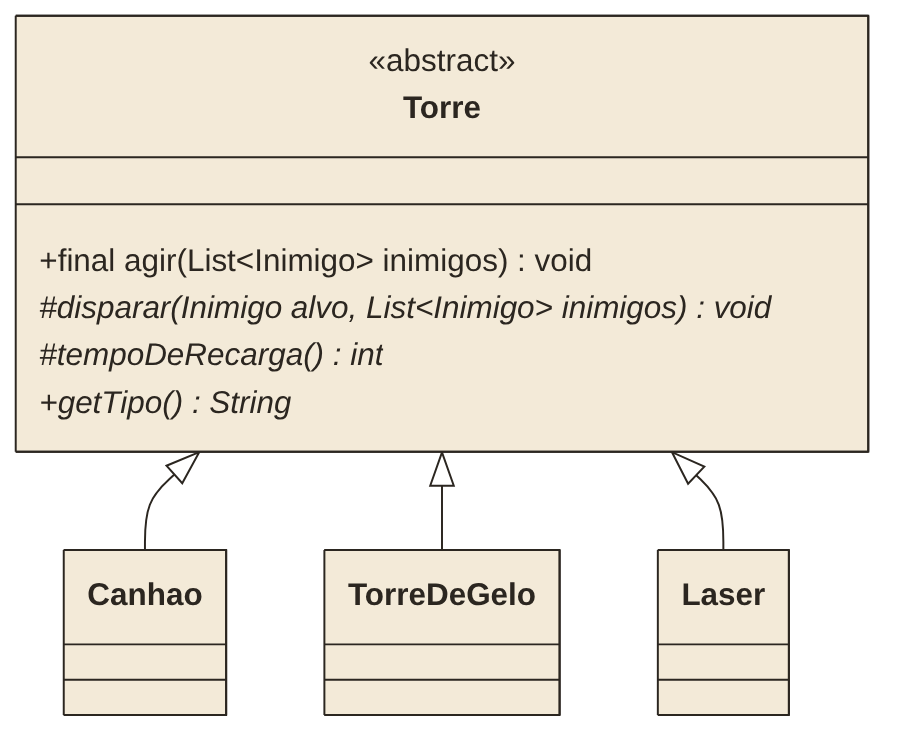
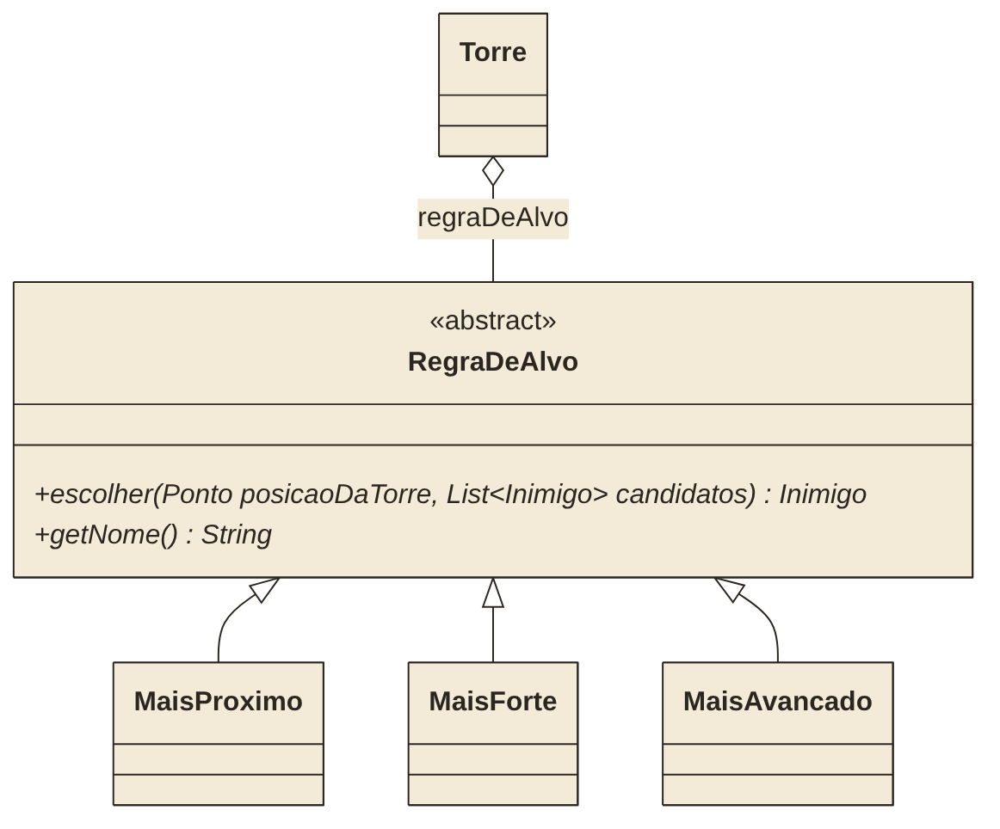

# Defesa da Torre

---

Inimigos entram pelo portão e seguem pela trilha até a fortaleza. No caminho há três torres: um **Canhão**, uma **Torre de Gelo** e um **Laser**. Cada inimigo que chega à fortaleza tira uma vida. São 5 ondas, e a partida começa com 20 vidas.

O jogo já funciona. Rodem o projeto, cliquem em **Começar** e assistam a uma partida inteira. No painel da direita, cada torre tem uma **regra de alvo**, que define em quem ela atira quando há mais de um inimigo no alcance. Troquem as regras e vejam como o resultado muda.

Mas o código tem um problema. A classe `Torre` faz tudo sozinha, e cada nova torre ou nova regra de alvo exige mexer nela de novo. A tarefa de vocês é **refatorar** o código, ou seja, mudar como ele está organizado sem mudar o que ele faz. A partida tem que terminar exatamente igual antes e depois da refatoração.

## Como rodar

1. Abram o projeto no IntelliJ.
2. Rodem a classe `DefesaApplication`.
3. Acessem <http://localhost:8080>.

## O que tem no projeto

```
br.com.senac.defesa
├── controller/PartidaController   não mexer
├── service/PartidaService         não mexer
├── dto/EstadoPartida              não mexer
└── model/
    ├── Ponto, Caminho, Inimigo     não mexer
    ├── Partida                     vocês mexem em dois lugares
    └── Torre                       é aqui que está o trabalho
```

A tela fica em `resources/static` e também não precisa de mudança. Ela só desenha o que o backend Java devolve.

## O problema

Abram a `Torre` e olhem o método `agir()`. Ele tem um `switch` com um `case` para cada tipo de torre, e os três cases fazem os mesmos passos, na mesma ordem:

```java
case "CANHAO":
    if (recarga > 0) { recarga--; break; }       // 1. está recarregando?
    alvo = escolherAlvo(inimigos);                // 2. escolhe o alvo
    if (alvo == null) { break; }
    angulo = Math.atan2(...);                     // 3. mira
    alvo.receberDano(16);                         // 4. dispara   <- só isso muda
    ...
    tiroAtual = alvo.getPosicao();
    recarga = 5;                                  // 5. recarrega <- e o tempo
    break;

case "GELO":
    if (recarga > 0) { recarga--; break; }       // tudo de novo...
```

Agora olhem o `escolherAlvo()`. Ele tem um `if/else` sobre a `String prioridade`, e cada bloco repete o filtro de alcance antes de aplicar o seu critério.

Alguns sintomas desse código:

- uma torre nova, por exemplo de veneno, exige mais um `case` e mais um pedaço copiado;
- se alguém mudar a ordem dos passos em um case e esquecer os outros, as torres passam a se comportar diferente sem ninguém perceber;
- uma regra nova, como "o mais rápido", exige mais um `else if` dentro da `Torre`, e a torre não tem nada a ver com isso;
- um erro de digitação como `"FORTEE"` compila e simplesmente não acerta ninguém.

## Parte 1: Template Method

Aqui o `agir()` é o algoritmo com passos fixos, e só o disparo e o tempo de recarga mudam de uma torre para outra.




1. Transformem `Torre` em classe abstrata.
2. Reescrevam o `agir()` uma única vez, com os passos na ordem atual, e marquem o método como `final`. Ele chama os métodos abstratos `disparar(...)` e `tempoDeRecarga()` nos passos que mudam.
3. Criem `Canhao`, `TorreDeGelo` e `Laser`. Cada uma recebe no construtor o `id` e a `posicao`, e passa o seu alcance para a `Torre` com `super(...)`. Os números de dano, recarga e alcance estão no código atual: é só levá-los para a classe certa.
4. `getTipo()` continua devolvendo `"CANHAO"`, `"GELO"` ou `"LASER"`, porque a tela usa esse texto para desenhar a torre.
5. No construtor da `Partida`, troquem `new Torre(1, "CANHAO", ...)` pela subclasse certa.

Ao terminar a Parte 1, não deve sobrar nenhum `switch` na `Torre`.

## Parte 2: Strategy

A ideia é tirar a regra de alvo de dentro da `Torre` e transformar cada regra em um objeto. A torre guarda o objeto da regra e pede a ele: "destes inimigos, em quem eu atiro?". Para trocar de regra, basta trocar o objeto, e isso pode ser feito com a partida rolando.

Leiam a explicação do padrão no Refactoring Guru antes de começar: <https://refactoring.guru/pt-br/design-patterns/strategy>

> O site mostra o Strategy com **interface**. Como vocês ainda não viram interface, usem uma **classe abstrata**. A ideia do padrão continua a mesma.



1. Criem a classe abstrata `RegraDeAlvo` com os dois métodos do diagrama.
2. Criem `MaisProximo`, `MaisForte` e `MaisAvancado`, levando para cada uma o critério que hoje está no `if/else`. O `getNome()` devolve `"PROXIMO"`, `"FORTE"` ou `"AVANCADO"`.
3. A `Torre` ganha um atributo `RegraDeAlvo regraDeAlvo`, que começa como `new MaisProximo()`, e um `setRegraDeAlvo(...)`. O atributo `String prioridade` deixa de existir.
4. O filtro de alcance fica **na `Torre`**, e escrito uma vez só. A regra recebe em `candidatos` apenas os inimigos vivos que estão no alcance e só decide quem entre eles vai levar o tiro.
5. `getPrioridade()` continua existindo e devolvendo o texto, porque a tela usa esse valor. Agora ele só repassa o `getNome()` da regra.
6. Na `Partida`, o `mudarPrioridade(int torreId, String prioridade)` recebe o texto que vem da tela. Ali vocês criam o objeto da regra correspondente e entregam para a torre.

Ao terminar a Parte 2, não deve sobrar nenhum `if/else` de prioridade na `Torre`.

## Como conferir se não quebrou nada

A partida não tem nada aleatório. Com as mesmas regras de alvo, ela termina sempre com o mesmo resultado, até no número do tick. Façam assim:

1. **Antes de mexer no código**, joguem algumas partidas com as combinações abaixo e confiram se dá o mesmo resultado da tabela. Para cada partida, escolham as regras **antes** de clicar em Começar e não troquem no meio.
2. Depois da Parte 1, repitam as partidas.
3. Depois da Parte 2, repitam de novo.

| Canhão | Torre de Gelo | Laser | Vidas | Abatidos | Tick final |
|---|---|---|---|---|---|
| Mais próximo | Mais próximo | Mais próximo | 17 | 36 | 894 |
| Mais forte | Mais forte | Mais forte | 2 | 21 | 796 |
| Mais próximo | Mais forte | Mais avançado | 20 | 39 | 811 |

Se o resultado mudar, algum passo mudou de ordem ou algum número foi parar na classe errada.

Usem o **4×** para não esperar tanto.
